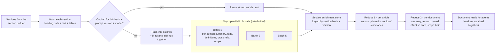
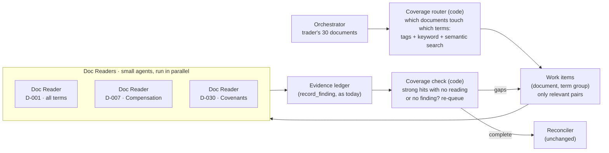

# Scaling Plan — comp-doc-extractor

Last updated: 2026-10-30 · Live doc: https://claude.ai/artifact/XzkESiWJPKx4NeLcwQ8V2p

## Goal and scale target

The system must handle **30 documents per trader, each up to 200 pages: up to 6,000 pages per trader**, without changing what the agents see. This plan tackles the bottlenecks one at a time; Part 1 is Docling conversion, because every later step waits on it.

| Target | Value |
| --- | --- |
| Documents per trader | up to 30 |
| Pages per document | up to 200 |
| Pages per trader | up to 6,000 |
| Number of traders | open question (see below) |
| Conversion runs | once per new or changed file; cached by file hash |
| New-document latency | minutes, not hours, for a single 200-page document |
| Backfill | the whole book within a planned window (e.g. a weekend) |

## Where we are today

Today every document is converted one at a time, in one process, as a whole file. That works for the prototype's 26 short documents but not for 6,000 pages per trader.

Measured on the prototype (Apple Silicon laptop, CPU only, 26 synthetic documents of 1-2 pages):

| Format | Docs | Avg seconds per doc | Avg pages | Notes |
| --- | --- | --- | --- | --- |
| PDF (born digital) | 14 | 1.07 | 1.4 | about 0.75 s per page once models are loaded |
| PDF (scanned, OCR) | 1 | 1.92 | 1.0 | macOS Vision OCR |
| DOCX | 11 | 0.02 | n/a | read directly, no models |
| First run (cold) | 1 | 98 | 2 | model download and load, paid once per process |

Why it won't scale as is:

- **One process, one file at a time.** At ~0.75 s per page, 6,000 pages is about 75 minutes per trader, longer with scans.
- **Whole-file conversion.** A 200-page PDF is one long job: one bad page fails or times out the whole document, and a retry redoes all 200 pages.
- **Same pipeline for every page.** OCR and accurate table recognition run whether or not a page needs them.
- **Model load inside the job.** A cold start costs ~100 s; short-lived workers would pay it again and again.

These timings come from tiny documents. Real 200-page contracts must be benchmarked before sizing hardware (milestone M1).

**M1 benchmark (2026-10-30, `benchmarks/docling_bench.py`, same laptop, CPU, models already downloaded), on a 202-page synthetic agreement:**

| Case | Pages | Seconds per page | Peak memory |
| --- | --- | --- | --- |
| Whole file, OCR on (today's settings) | 202 | 0.20 (40 s total) | 2.2 GB |
| Whole file, OCR off | 202 | 0.21 | 2.0 GB |
| Digital slice, OCR off / on | 14 | 0.36 / 0.25 | ~1 GB |
| Table pages, accurate / fast TableFormer | 2 | 1.03 / 0.74 | ~1 GB |
| Scanned page / fully scanned 8-page doc (OCR) | 1 / 8 | 1.9 / 1.2 | ~1 GB |
| Model load per process (warm disk cache) | | 6-10 s | |

**M2 sharding result (`benchmarks/shard_bench.py`, same 202-page PDF, same laptop):**

| Scenario | Seconds | Outcome |
| --- | --- | --- |
| Whole file, 1 process | 59 | success |
| 7 shards, 2 local workers | 77 | success; sections identical to whole file (279/279) |
| 7 shards, 4 local workers | 126 | success |
| Transient failure on page 45 | 157 | retried once, success |
| Page 45 always fails | 213 | shard split down to page 45; 201/202 pages kept; `partial_success` with page 45 flagged |

**Decision:** on a single CPU machine, sharding is slower, because Docling already uses every core in one process and extra local workers compete for CPU and memory. So the default is **one whole document per worker** (`COMPDOC_CONVERT_WORKERS=1`), and the sharded path is switched on when workers run on separate machines or GPUs (M3), where it cuts wall time per document and isolates failures. Paragraphs split at a page or shard break are rejoined by the section builder, so both paths give the same sections.

What this changes: large files convert at **~0.2 s per page**, about 4x faster than the small-file estimate, so one trader's 6,000 pages is ~20 minutes in one process. OCR on digital pages costs almost nothing (Docling only OCRs image regions), so strategy 3 matters little. Small slices cost more per page than large ones (fixed overhead per call), so shards should be ~25-50 pages, not smaller. Each worker needs 1-2 GB of memory.

## Part 1 · Docling conversion: strategies

**Yes, chunk and fan out: a coordinator splits each PDF into page ranges, a pool of workers converts them in parallel, and the coordinator merges the results.** The installed Docling supports both halves: `convert(source, page_range=(start, end))` converts a slice, and `DoclingDocument.concatenate([...])` joins the slices back into one document.

**The workers should be plain processes, not LLM agents.** Conversion is deterministic: there is no judgement to make, only layout models to run. An LLM per chunk would add cost, latency and run-to-run variation, and could not convert pages anyway. LLMs come in later, at enrichment and research, on the merged sections.

Strategies, ranked by impact:

| # | Strategy | What it does | Expected gain | Cost or risk |
| --- | --- | --- | --- | --- |
| 1 | Page-range sharding | Split a PDF into shards of ~20-25 pages; convert shards in parallel; merge in page order | Wall time for one 200-page doc falls roughly by the number of workers | Merge must keep page numbers and item order; tables split across a shard boundary |
| 2 | Page triage before conversion | A cheap probe (pypdfium2) checks each page for a text layer and images | Decides OCR per page instead of per file | Probe adds ~0.01 s per page |
| 3 | OCR only where needed | Born-digital pages skip OCR; scanned pages get it | Large saving on digital PDFs, which are most contracts | Mixed files (scanned signature pages) need per-shard settings |
| 4 | Table model only where needed | Accurate TableFormer on pages with tables; skip or fast mode elsewhere | Table recognition is the slowest model step | Requires the probe or layout pass to spot tables |
| 5 | Warm worker pool | Workers load Docling models once and stay up; models pre-downloaded (`artifacts_path`) | Removes the ~100 s cold start per job | Each worker holds ~2-4 GB of memory |
| 6 | Docling's own batching | Tune `layout_batch_size`, `table_batch_size`, `ocr_batch_size`, `AcceleratorOptions(num_threads, device)` | Better use of each machine's cores or GPU | Needs a benchmark per machine type |
| 7 | GPU workers | `device=cuda` for layout and table models | Several times faster per page on GPU (to be measured) | GPU cost; only worth it for backfill-scale volume |
| 8 | Cache at shard level | Key = file hash + page range + pipeline version | A retry or a re-run converts only failed or changed shards | More cache entries to manage |
| 9 | De-duplicate files | Identical files (same hash) across traders convert once | Saves the template contracts many traders share | None |
| 10 | DOCX stays whole | Word files are read directly in ~0.02 s | No sharding needed | Very large DOCX can be split by section later if needed |
| 11 | Prioritised queue | On-demand requests jump ahead of backfill | A new document is ready in minutes during a backfill | Needs a queue with priorities |

Strategies 1, 2, 3, 5 and 8 are the core of the design below; 4, 6 and 7 are tuning once the benchmark shows where time goes.

## Part 1 · Recommended architecture

**A coordinator probes and splits each PDF, a pool of warm workers converts the shards in parallel, and the coordinator merges them back into one Docling document before the existing section builder runs.**

```mermaid
flowchart LR
    SRC["Source document<br/>PDF up to 200 pages<br/>from the document DB / S3"] --> COORD["Coordinator (code)<br/>probe each page (text / scan)<br/>plan ~25-page shards"]
    COORD --> Q["Shard queue<br/>on-demand jobs go first<br/>lease and retry per shard"]
    Q -- shard jobs --> POOL
    subgraph POOL["Warm worker pool · processes, not LLM agents"]
        W1["Worker 1<br/>pages 1-25<br/>digital: OCR off<br/>models loaded once"]
        W2["Worker 2<br/>pages 26-50<br/>digital: OCR off<br/>TableFormer on table pages"]
        WN["Worker N<br/>pages 176-200<br/>scanned: OCR on<br/>retry or split on failure"]
    end
    POOL -- shard results --> CACHE["Shard cache<br/>key: file hash + page range<br/>+ pipeline version"]
    CACHE --> MERGE["Coordinator: merge<br/>concatenate in page order<br/>check every page 1..N once"]
    MERGE --> SB["Section builder + QC<br/>runs once on the merged doc<br/>unchanged from today"]
```

The coordinator is the master you asked about, and the workers are its helpers; both are code. Everything after the merge (section builder, QC, LLM enrichment) stays as it is today, so the agents see the same sections. DOCX files skip sharding: they are read whole in ~0.02 s and go straight to the section builder.

The flow, step by step:

1. **Probe** (coordinator): count pages; per page, check for a text layer and large images to mark it digital or scanned.
2. **Plan shards**: ~25 pages each, never mixing digital and scanned pages when avoidable, so each shard gets the right settings (OCR on or off).
3. **Check the shard cache**: shards already converted with the same file hash, page range and pipeline version are reused.
4. **Queue** the rest with the document's priority; workers lease shards so a dead worker's shard is picked up by another.
5. **Convert** (worker): `convert(path, page_range=(start, end))` with models already loaded; the result is saved to the shard cache.
6. **Merge** (coordinator): when all shards are in, `DoclingDocument.concatenate` in page order, then check every page appears exactly once.
7. **Hand over** the merged document to the section builder and QC, as today.

## Part 1 · Capacity estimate

**With 8 warm workers, one trader's 6,000 pages convert in about 12-15 minutes, and a single 200-page document in under a minute.** These are estimates from the prototype's per-page timings (0.75 s per digital page, ~2 s per scanned page, CPU only) and must be replaced by the M1 benchmark.

Assumed mix: 80% born-digital pages, 20% scanned pages (about 100 worker-minutes per trader).

| Scenario | Workers | Wall time (estimate) |
| --- | --- | --- |
| One 200-page digital doc, 8 shards of 25 pages | 8 | ~20-30 s plus merge |
| One trader, 6,000 pages | 1 | ~100 min |
| One trader, 6,000 pages | 8 | ~12-15 min |
| One trader, 6,000 pages | 32 | ~3-4 min |
| Backfill of 500 traders (illustrative) | 32 | ~26 h |

Storage, measured at ~11 KB of Docling JSON per page:

| Item | Size (estimate) |
| --- | --- |
| One 200-page document | ~2.2 MB JSON + a smaller markdown file |
| One trader (6,000 pages) | ~66 MB |
| Worker memory | ~2-4 GB per warm worker (to confirm) |

The trader count drives the backfill size and is still an open question.

## Part 1 · Failure handling and quality checks

**A failure costs one shard, never the whole document, and a document is marked ready only when every page is accounted for.**

| Problem | Detection | Response |
| --- | --- | --- |
| Shard crashes or times out | Worker error or `document_timeout` hit | Retry the shard up to 2 times, then split it in half and retry each half |
| One page keeps failing | Same page fails at shard size 1 | Convert it with a fallback (text layer only, or OCR only) and flag the page |
| Shard returns partial success | Docling status `PARTIAL_SUCCESS` | Keep the result, record the missing pages, flag the document in QC |
| Pages missing after merge | Page coverage check: every page 1..N appears exactly once | Document stays "not ready"; missing shards re-queued |
| Scanned page treated as digital | Low text on a page with a large image (probe vs output) | Re-run that page with OCR |
| Heading or table split at a shard boundary | Section builder runs on the merged document, not per shard | Numbering-based nesting already joins clauses across the boundary; a table split across pages is flagged in QC as "table continues" |
| Worker dies mid-shard | Lease on the shard expires | Another worker picks the shard up; cache key makes the redo safe |
| Wrong Docling version mixed in | Pipeline version stored on every shard | Shards from an older pipeline version are not merged; they are reconverted |

New QC fields per document: shards, shard retries, pages converted vs expected, pages OCR'd, pages flagged, pipeline version. The Dev Console's Document lifecycle page gains a "Shards" step showing each shard's range, worker, time and status.

## Part 1 · Milestones and acceptance

**Build in four steps, each proven on large documents before the next.**

1. **M1 · Benchmark at real size.** Extend the synthetic generator to 200-page contracts (schedules, tables, exhibits, scanned signature pages) and record seconds per page by page type, memory per worker, and cold-start time.
    - Done when: we have measured per-page timings for digital, scanned and table pages on this laptop and on one target cloud machine.
2. **M2 · Probe, shard, merge on one machine.** Page probe, shard planner, a local process pool of warm workers, merge with `concatenate`, page coverage check, shard-level cache.
    - Done when: a 200-page PDF converts with 8 workers, the merged result matches a whole-file conversion (same items, same pages), and killing a worker mid-run still ends with a complete document.
3. **M3 · Queue and remote workers.** Put shards on a queue (Temporal activities or SQS) so workers can run on other machines, with priorities and shard leases.
    - Done when: one trader's 30 documents (6,000 pages) convert across several machines inside the target time, and a new document jumps ahead of a running backfill.
4. **M4 · Observability.** Shard spans in the trace, the "Shards" step in the Document lifecycle page, throughput and failure metrics.
    - Done when: for any document you can see every shard, its worker, timing, retries and result.

Acceptance for Part 1 overall: no change to the sections the agents receive (the extraction eval still scores the same), and conversion time per trader within the target agreed in the open questions.

## Part 2 · Enrichment at scale

**Enrich per section, not per document: split sections into token-sized batches that run in parallel (map), build the document-level fields from all batches (reduce), and cache every section's result by its content hash so later runs only enrich what changed.**

### What breaks today

| Problem | Today's behaviour | Effect on a 200-page document |
| --- | --- | --- |
| Sequential batches | Batches of 40 sections, one call after another | ~500 sections = 13+ calls back to back, several minutes per document |
| First-batch document fields | `doc_summary`, effective date and scope note come from whichever batch ran first | Summary describes only the first pages; a date or scope limit on page 150 is missed |
| Whole-document cache | Cached per document + prompt version + model | Any change (new prompt, one re-OCR'd page) re-enriches all ~500 sections |
| Fixed batch size | 40 sections regardless of length | One long schedule or table can overflow a call; tiny clauses waste calls |
| No partial recovery | One failed batch fails the document's enrichment | A transient API error costs the whole document |

Measured on the prototype (gpt-5.4-mini, 53 calls): ~11 sections per call, ~1,560 input and ~890 output tokens, ~5 s per call, ~$0.0002 per section.

### Design: map, reduce, cache

1. **Hash every section.** Key = hash of its heading path, text and tables. The enrichment of an unchanged section is reused, even if the document around it changed.
2. **Pack batches by tokens, not count.** About 8k input tokens per batch; keep sibling clauses together so the model sees their context. Each section carries its heading path, and the batch carries the document's title, type and date.
3. **Map in parallel.** Run batches concurrently under a shared rate limiter (requests and tokens per minute) with retries per batch. Each batch returns per-section fields plus **document signals** it noticed: stated effective dates, period limits, parties, what the document does. Each signal cites its section.
4. **Check completeness.** Every section in a batch must come back exactly once. Missing sections are retried alone; tags outside the taxonomy are dropped (as today).
5. **Reduce per article.** For each top-level article (e.g. "4. Compensation"), one short call turns its sections' summaries into an article summary. Input is summaries, not raw text, so it stays small however long the article is.
6. **Reduce per document.** One call reads the article summaries plus all document signals and writes the document summary, effective date and scope limit, citing the section each comes from. `terms_covered` stays computed from the union of section tags (no LLM). The effective-date quote is verified against the section text, like findings are.
7. **Switch versions together.** New enrichment is written as a new version; the document flips to it only when every section and both reduces are done, so agents never see a half-old, half-new document.

The article summaries are also what Part 3 (researcher context limits) needs: a two-level outline (articles first, then the sections of the chosen articles) instead of 500 lines per document.

### Keeping it enriched over time

**Enrichment is a standing job, not a one-off: every change re-enriches only what it touches, in the background, with the current version serving until the new one is complete.**

| Trigger | What gets re-enriched | Priority |
| --- | --- | --- |
| New document | All its sections, then article and document reduces | High (someone is waiting) |
| Changed document (new file hash) | Only sections whose hash changed; then the reduces for the articles they sit in, and the document | High |
| Section builder improved (e.g. better numbering) | Only sections whose text or path changed | Background |
| Prompt or model change | All sections, as a background version roll-out | Background, under a daily budget |
| Taxonomy change (new term or sub-term) | A cheaper tags-only pass on sections likely to match (keyword pre-filter), not a full re-enrichment | Background |
| Tag miss detected | The missed section (see feedback loop below) | Background |

Feedback loop, so tagging improves with use:

- **Tag misses from researchers.** When a Term Researcher's backstop search finds a relevant section that its outline-based choice missed, or records a finding from a section not tagged with that term, log a tag-miss event. The section is queued for re-tagging, and the case is added to the tagging eval set.
- **Reviewer corrections.** When a human corrects a value whose section was mis-tagged, the same event is logged.
- **Prompt roll-out gate.** A new enrichment prompt runs first on the eval set (tag precision and recall, summary quality checks) and in shadow on a sample of documents; it rolls out only if it beats the current version.

### Capacity estimate

Assumptions: ~2.5 sections per page (to confirm on real contracts), so ~500 sections per 200-page document; per-section cost and tokens as measured above.

| Scenario | Calls | Wall time (estimate) | Cost (estimate) |
| --- | --- | --- | --- |
| One 200-page document, sequential (today) | ~45 | ~4 min | ~$0.10 |
| One 200-page document, 8 batches in parallel | ~20 map + ~10 article + 1 doc | ~30-40 s | ~$0.10 |
| One trader, 30 documents (15,000 sections) | ~600 map + reduces | ~5-10 min, bounded by rate limits | ~$3 |
| Re-run after one page changed | 1-2 map + 2 reduces | seconds | < $0.01 |
| Prompt change, 500 traders, background | ~300,000 | days, within a daily budget | ~$1,500 |

### Storage changes

| Table | Purpose |
| --- | --- |
| `section_enrichment` | One row per section hash + prompt version + model: summary, tags, definitions, cross refs, scope notes, document signals |
| `article_enrichment` | One row per article and version: article summary and the section hashes it was built from |
| `doc_enrichment` | Adds `version`, `status` (building / live / retired) and citations for effective date and scope |
| `enrichment_jobs` | Queue of work: target (section, article, document), reason (trigger), priority, attempts, status |
| `tag_miss_events` | Feedback: section, term, how it was detected, run id |

### Milestones

1. **E1 · Section-level cache.** Section hashes, the `section_enrichment` table, reuse of unchanged sections.
    - Done when: re-ingesting a document with one changed page re-enriches only the affected sections.
2. **E2 · Parallel token-sized batches.** Token-based packing, a concurrency pool with a shared rate limiter, per-batch retry, completeness check.
    - Done when: a 200-page synthetic document enriches in under a minute with no section missing.
3. **E3 · Two-level reduce.** Article summaries, document summary from all articles, document signals with cited and verified sections.
    - Done when: an effective date stated on page 150 appears in the document fields with its citation.
4. **E4 · Versioned background re-enrichment.** Job queue, triggers, priorities, daily budget, atomic version switch.
    - Done when: a prompt change rolls out in the background while agents keep using the previous version, then switches per document.
5. **E5 · Feedback loop and tagging eval.** Tag-miss events, eval set, shadow runs and roll-out gate.
    - Done when: each prompt version has a tag precision/recall score and roll-outs are gated on it.

Acceptance for Part 2 overall: the extraction eval scores the same or better, and the Dev Console's Document lifecycle page shows enrichment per batch, cache hits, versions and the reduce steps.

## Part 3 · Researcher context limits

**Split the research into many small agents, one per document (and per term group for large documents), each seeing a two-level outline of one document only; feed them candidates from three recall signals: term tags, keyword search and a new semantic search.**

### Why today's researchers break at scale

Today each Term Researcher reads the outlines of **all** the trader's documents in one call.

| | Prototype (T-1003) | At scale (30 docs × 200 pages) |
| --- | --- | --- |
| Sections per trader | ~44 | ~15,000 |
| Outline size (heading + summary + tags, ~50 tokens a line) | ~2k tokens | ~750k tokens per researcher call |
| Researchers per trader | 5-6 | 5-6, each re-sending that outline every turn |
| Result | works | over the context limit, and far too slow and costly even where it fits |

A filtered outline (only tagged sections) shrinks this, but leans entirely on the tags; a missed tag means a missed value.

### Should we split into multiple small agents? Yes, by document

The key fact: **a researcher never needs to see two documents at once.** It only records what each document says; the Reconciler is the step that compares documents by date. So the natural unit of work is one document (or one document and a group of terms), not one term across all documents.

| Option | Context per agent | Agents per trader | Verdict |
| --- | --- | --- | --- |
| One researcher per term, all docs (today) | ~750k tokens | 6 | Does not fit |
| Per term, filtered outline across all docs | depends on tags | 6 | Fits, but tag misses become value misses |
| Per document, all terms | one doc: ~1-2k (articles) + chosen sections | ~30 | Fits; each section read once even if it serves several terms |
| Per document × term | one doc, one term | up to 180 | Fits, but many empty agents (most amendments touch one or two terms) |
| **Adaptive: per document, split by term group only for large documents** | bounded (target < 40k tokens) | ~30-60 | **Recommended** |

Short documents (amendments, side letters, memos) get one **Doc Reader** covering every term. A long base agreement gets several Doc Readers, one per term group (e.g. Compensation + Deferral; Covenants + Termination), so no single agent's reading list grows too large.

### Design

What each Doc Reader does:

1. **Starts with a shortlist.** The router hands it candidate sections for its terms from three signals: tags, keyword (BM25) hits and semantic hits, fused into one ranked list.
2. **Sees a two-level outline.** First the document's articles (heading, article summary from Part 2, tags), about 15-30 lines; then, on request, the sections of the articles it chooses.
3. **Reads chosen sections** and records findings with quotes, exactly as today.
4. **Can search inside its document** if the shortlist and outline look incomplete.

The context stays bounded because the agent only ever holds one document's articles, a few articles' sections, and the sections it read.

**Coverage check (code, after the readers).** For every document and term, compare: did search show strong evidence of the term? Was any section of it read? Was any finding recorded? A strong hit that was never read is re-queued to a Doc Reader; a gap that remains after one retry is flagged in the extract for review.

**Cheaper model where it is enough.** Doc Readers have a narrow job, so they can start on the cheaper model (gpt-5.4-mini) and hand over to gpt-5.5 only when unsure (conflicting wording, a scope limit, a removal). Keep each agent's stable prefix (instructions, taxonomy) first so the API's prompt caching applies across the 30-60 agents.

### Should we add semantic search? Yes, as a recall layer

Contracts say the same thing in different words. Keyword search finds "payout" but misses "incentive compensation", "bonus pool allocation" or "discretionary award"; tags depend on the enrichment model getting every section right. Semantic search (embeddings) finds sections by meaning.

| Signal | Good at | Misses |
| --- | --- | --- |
| Term tags (enrichment) | Precise when right; cheap at query time | Anything the tagger got wrong |
| Keyword search (BM25) | Exact words, numbers, clause references ("4.3", "US$1,500,000") | Synonyms and paraphrases |
| Semantic search (embeddings) | Paraphrases, unusual wording, cross-trader "find similar clause" | Exact numbers and references; can return related but wrong sections |
| **Hybrid: all three fused (reciprocal rank fusion)** | **High recall; the agent still reads before recording** | Costs one embedding per section at ingest |

Where it pays off:

- **Coverage router:** decide which documents touch a term, without relying on tags alone.
- **Doc Reader shortlist:** better candidates, so fewer sections are read.
- **Chat and Term Finder:** "which traders have something like a guarantee" across differently worded documents.
- **Clause variants:** group wordings by meaning instead of word overlap.

Design choices:

| Choice | Recommendation | Why |
| --- | --- | --- |
| What to embed | Each section as heading path + text, split into ~500-token chunks for long sections; plus the article summary | Matches how agents navigate (articles, then sections) |
| Embedding model | A local open model (e.g. a small BGE or E5 model) by default; a hosted model is an option | Contract text never leaves the firm; no per-call cost; good enough for retrieval |
| Where vectors live | Prototype: SQLite with a vector extension next to FTS5; production: Postgres with pgvector, or OpenSearch (keyword + vector in one engine) | Keyword and vector queries filtered by trader in one place |
| When to embed | At ingest, after the section builder, cached by section hash (same as Part 2) | Unchanged sections are never re-embedded |
| Safety | Semantic hits only point to sections; values still come from reading the text, with verified quotes | A wrong hit costs a read, never a wrong value |

Rough size: ~15,000 sections per trader at ~300 tokens each is ~4.5M tokens to embed once per trader; minutes on a local model, cents on a hosted one (to measure).

**Measure before committing.** Our synthetic contracts use the same few wordings, so semantic search will look useless on them. The generator needs paraphrased variants (synonyms, reordered clauses, different section names) and the eval needs a **recall@k** check: for each gold finding, is its section in the top k candidates from tags only, keyword only, semantic only, and hybrid?

### Capacity and cost estimate

Assumptions: ~45 relevant (document, term group) work items per trader; each Doc Reader ~4 turns, ~70k input tokens summed over its turns and ~3k output tokens.

| Scenario | Agents | Wall time (estimate) | Cost (estimate) |
| --- | --- | --- | --- |
| Today's design at scale | 6 | does not fit the context | n/a |
| Doc Readers on gpt-5.5 | ~45 | ~2-4 min (parallel, rate-limited) | ~$5-7 per trader |
| Doc Readers on gpt-5.4-mini, escalate ~10% | ~45 (+ ~5) | ~2-4 min | ~$1-2 per trader |
| Re-extract after one new amendment | 1-3 | < 1 min | cents |

The last row matters most day to day: with per-document work items, a new amendment only needs Doc Readers for that one document, then a re-run of the Reconciler over the stored findings of all documents.

### Milestones

1. **R1 · Two-level outline tools.** `get_article_outline(doc)` and `get_section_outline(doc, article)`, using article summaries from Part 2 (until then: article headings + their sections' tags).
    - Done when: a 200-page synthetic document's article outline is under 2k tokens.
2. **R2 · Router, work items and Doc Readers.** The coverage router, adaptive (document, term group) work items, Doc Reader agents fanned out with LangGraph `Send`, a concurrency limit.
    - Done when: a 30-document, 6,000-page synthetic trader extracts with no agent over 40k tokens of context and the extraction eval scores the same as today.
3. **R3 · Coverage check.** Strong-hit-but-unread detection, one re-queue, flags in the extract.
    - Done when: deleting a section's tags in a test still yields its value through the coverage check.
4. **R4 · Hybrid search.** Section embeddings at ingest (cached by section hash), vector store, rank fusion with BM25 and tags, paraphrased synthetic set, recall@k eval.
    - Done when: hybrid recall@10 beats tags + keyword on the paraphrased set, or we drop semantic search with the numbers to show why.
5. **R5 · Model tiering and incremental re-extraction.** Doc Readers on the cheaper model with escalation; a new document triggers only its own Doc Readers plus the Reconciler.
    - Done when: cost per trader and per new document are tracked in the Dev Console and within budget.

Acceptance for Part 3 overall: extraction eval unchanged or better at 6,000 pages per trader, and the Dev Console's Ask & trace page shows each Doc Reader, its shortlist (with which signal found each candidate), the sections it chose and why.

## Part 4 · Quote verification

**Store each section's normalised text and a map from text position to Docling item at ingest, so verifying a quote and locating it on the page become database lookups; Docling JSON is never read while agents run.**

### What it is and why it matters

Every value a researcher records carries an exact quote. `verify_quote` checks that the quote appears in the cited section and contains the value; if not, the value is marked "needs review" instead of trusted. It is the main guard against an LLM inventing a value. `locate_quote` then finds the exact Docling item, page and bounding box for the citation.

### What happens today

| Step | Today | Cost now | Cost at scale |
| --- | --- | --- | --- |
| Quote found in the cited section (normal case) | Substring search on the section text in the database | fast | fast |
| Quote not in the cited section | Parses the whole Docling JSON to report "found elsewhere in the document"; not cached | small (15 KB files) | ~2 MB JSON per 200-page doc, ~50-100 ms per parse, repeated |
| Locating the Docling item, page, box | Parses the Docling JSON; cached per process (64 docs) | small | every parallel worker loads the same files again, from S3 in production |
| Quote spans two Docling items (sentence across a page break) | Not located | rare | common in long documents |
| OCR quirks (hyphenated line breaks, odd spacing) | Exact match fails → "unverified" | rare | more false review flags on scanned pages |

So the problem is not every finding, but the fallback and location paths, multiplied by many workers and long, scanned documents.

### Design

1. **At ingest (after the section builder), store per section:**
    - its normalised text (same normalisation `verify_quote` uses: quotes, whitespace, case, `P&L;` artifacts);
    - a **position map**: character ranges in that text → Docling item ref, page and bounding box.
2. **`verify_quote` becomes a search in stored text:** exact match in the cited section first; then a tolerant match (ignore hyphenation at line breaks, collapse spacing) that is marked as such; then a document-wide search over the same table to report "found in another section".
3. **`locate_quote` uses the match position:** the matched character range → the item(s) it covers → page and box (several boxes if the quote spans items or a page break).
4. **Keyed by section hash** (as in Parts 2 and 3), so unchanged sections are never rebuilt.
5. **Docling JSON stays the source of truth** for re-processing and the Dev Console, but is no longer read while agents run.

| Table | Contents |
| --- | --- |
| `section_text` | section id, section hash, normalised text |
| `section_spans` | section id, start, end, Docling item ref, page, bounding box |

### Effect

| | Today | After |
| --- | --- | --- |
| Verify, normal case | DB substring search | same |
| Verify, fallback | parse ~2 MB JSON | DB search |
| Locate item, page, box | parse JSON (cached per process) | DB lookup |
| Quotes across a page break | not located | located, with two boxes |
| OCR line-break hyphenation | false "unverified" | matched, marked as tolerant match |

### Milestones

1. **Q1 · Text and span store at ingest.** Build `section_text` and `section_spans` from the Docling document; backfill existing documents from the cache.
    - Done when: every section of every ingested document has stored text and spans.
2. **Q2 · Verify and locate from the store.** Rewrite `verify_quote` and `locate_quote` on the new tables; tolerant matching for OCR text.
    - Done when: no Docling JSON is opened during an extraction run (checked in the trace), and the extraction eval scores the same.
3. **Q3 · Multi-item quotes.** Citations that cross items or pages return all their boxes; the chat "Show on page" highlights each.
    - Done when: a quote across a page break in a synthetic 200-page document is located on both pages.

## Part 5 · Section builder on real contracts

**Replace the "dotted number" rule with a numbering parser that recognises every common label style, assigns levels by the order styles appear (a style stack, like Word's list levels), validates sibling sequences, and treats schedules and exhibits as their own top-level parts. An LLM is used only to repair documents that still fail the checks.**

### What real contracts look like (and today's builder misses)

| Pattern | Example | Today |
| --- | --- | --- |
| Articles in Roman numerals | `ARTICLE IV - COMPENSATION` | not recognised as a number |
| "Section" labels, zero-padded | `Section 4.02 Payout.` | `4.02` vs `4.2` treated as different |
| Deep decimal | `4.2.1.3` | works |
| Lettered and roman clauses | `(a)`, `(i)`, `(A)`, `(1)` | text only; not sections |
| Ambiguous letters | `(i)` after `(h)` is a letter; after `(iv)`, `(v)` is roman | n/a |
| Run-in headings | `4.2 Payout. The Trader shall receive...` (heading and body on one line) | whole line becomes a heading |
| Attachments | `Schedule A - Vesting Schedule`, `Exhibit B`, `Annex 1`, `Appendix` | numbered into the body or lost |
| Unnumbered parts | Recitals (`WHEREAS`), `NOW, THEREFORE`, signature pages | mixed into the preamble or the last clause |
| Table of contents | page 2 lists every heading with page numbers | its lines would become fake headings |
| Running headers and footers | `Confidential - Employment Agreement - Page 12 of 200` on every page | only a fixed list of phrases is dropped |
| Word auto-numbering | heading numbers live in Word's numbering settings, not in the text | numbers missing for DOCX |

### Design: parse, stack, validate, repair

1. **Clean before parsing.**
    - **Table of contents:** pages whose lines mostly end in page numbers or dot leaders, and whose headings reappear later, are dropped (kept in QC as "TOC page").
    - **Running headers and footers:** text that repeats at the same position on many pages is dropped by frequency, not by a fixed phrase list.
    - **Signature pages and `[Signature page follows]`** become their own unnumbered part.
2. **Recognise the label at the start of each heading or paragraph** with one small grammar:

    | Label style | Matches | Normalised as |
    | --- | --- | --- |
    | Article | `ARTICLE IV`, `Article 4` | `art4` |
    | Section | `Section 4.02`, `§ 4.2` | `4.2` (zero padding removed) |
    | Decimal | `4`, `4.2`, `4.2.1` | as is |
    | Paren lower letter | `(a)` | `a` |
    | Paren lower roman | `(iv)` | `iv` |
    | Paren upper letter / number | `(A)`, `(1)` | `A`, `1` |
    | Attachment | `Schedule A`, `Exhibit B`, `Annex 1`, `Appendix C` | `schA`, `exhB`, `annex1`, `appC` |
    | Recitals / operative words | `WHEREAS`, `NOW, THEREFORE` | `recitals` |

3. **Split run-in headings.** `4.2 Payout. The Trader shall...` becomes label `4.2`, heading `Payout`, body `The Trader shall...`.
4. **Assign levels with a style stack.** The first label style seen is level 1; a new style nests one level deeper; returning to a style already in the stack pops back to its level. Decimal depth adds levels within the decimal style.
5. **Resolve letter vs roman by context.** `(i)` right after `(h)` is a letter; `(v)` right after `(iv)` is roman.
6. **Validate sibling sequences.** Siblings must run in order (`4.01 → 4.02`, `(a) → (b)`, `IV → V`). Gaps, repeats and out-of-order labels are repaired from neighbours (today's repair logic, generalised) or flagged.
7. **Attachments get their own namespace.** Schedules and exhibits are top-level parts beside the body, with their own numbering, so `schA.3` never collides with section 3. Pay grids and vesting tables often live there, so cross-references like "as set out in Schedule A" resolve to them.
8. **Use layout when numbering is missing.** For PDFs: font size, bold and left indent (from Docling's bounding boxes). For DOCX: Word heading styles and list levels; numbers that Word generates automatically are rebuilt from the document's numbering settings.
9. **LLM repair only for failures.** If a document still has unnumbered or out-of-order headings above a threshold, send the heading list only (no body text) to the LLM to propose levels; accept the proposal only if it passes the same sequence checks.

Example of the stack on a real-style excerpt:

| Line | Label style | Level | Section id |
| --- | --- | --- | --- |
| `ARTICLE IV - COMPENSATION` | Article | 1 | `D-005:art4` |
| `Section 4.02 Payout.` | Section | 2 | `D-005:art4.4.2` |
| `(a) Net Trading P&L ...` | Paren letter | 3 | `D-005:art4.4.2.a` |
| `(i) subject to the Hurdle ...` | Paren roman | 4 | `D-005:art4.4.2.a.i` |
| `(ii) after netting ...` | Paren roman | 4 | `D-005:art4.4.2.a.ii` |
| `(b) Payment timing ...` | Paren letter (pop) | 3 | `D-005:art4.4.2.b` |
| `SCHEDULE A - VESTING` | Attachment | 1 | `D-005:schA` |

**Granularity.** Clauses at `(a)` and below become sections, so citations can point to `4.02(a)(i)`. The two-level outline from Part 3 shows only articles and sections; clauses come with their section when it is read.

**Stable ids.** Section ids are built from normalised labels, so re-processing the same document gives the same ids, and citations and caches (Parts 2-4) stay valid.

### Testing

| Test set | Built from | Checks |
| --- | --- | --- |
| Synthetic structure variants | Generator extended with Article/Section/roman/(a)(i), run-in headings, schedules, TOC pages, running headers, auto-numbered DOCX | Section boundaries, parent and level, label, id |
| Golden snapshots | A dozen documents whose section trees are reviewed once and saved | Any change to the tree shows up as a diff in tests |
| Real redacted contracts | When available | Same metrics; the true test |

Metrics: section boundary F1, parent accuracy, label accuracy, share of headings repaired, share needing LLM repair.

### Milestones

1. **S1 · Structure test set.** Generator variants and golden snapshots; the metrics above in the eval harness.
    - Done when: today's builder has a baseline score on every pattern in the table above.
2. **S2 · Label grammar, run-in split, style stack, letter/roman resolution.**
    - Done when: Article/Section/(a)(i) documents score at least 0.98 on parent accuracy.
3. **S3 · Clean-up: TOC, running headers and footers by frequency, signature pages.**
    - Done when: no TOC line or running header becomes a section in the test set.
4. **S4 · Attachments and layout fallback.** Schedule/Exhibit namespaces, cross-references to them, font/indent fallback for PDF, Word numbering for DOCX.
    - Done when: a pay grid in Schedule A is found from "as set out in Schedule A", and auto-numbered DOCX keeps its numbers.
5. **S5 · LLM repair for failures and Dev Console view.** Heading-only LLM repair with validation; the Document lifecycle page shows the detected label styles, the stack decisions and repairs.
    - Done when: documents that fail the checks are repaired or flagged, and every decision is visible per document.

## Open questions

- [ ] How many traders, and how many new documents arrive per day? (sizes the backfill and the worker pool)
- [ ] What share of pages are scanned? (OCR is the slowest step)
- [ ] Target time: how fast must a newly uploaded document be ready? How long may a full backfill take?
- [ ] Where does it run: AWS (ECS/EKS, Batch), on-prem, or both? Are GPUs available?
- [ ] Queue: Temporal or Airflow (both named in the team's role description), or SQS/Celery?
- [ ] Are there formats other than PDF and DOCX (scanned TIFF, email attachments, Excel schedules)?
- [ ] Can source documents leave the firm's network? (Docling runs locally either way; this decides where workers may run.)

- [ ] Enrichment: what daily LLM budget is acceptable for background re-enrichment after a prompt change?
- [ ] Enrichment: how many sections per page do real contracts have? (drives call counts; 2.5 assumed)
- [ ] Semantic search: may section text be sent to a hosted embedding API, or must embeddings run inside the firm (local model)?
- [ ] Research: can we get a handful of real (redacted) contracts to build the paraphrase and recall@k test set?

## Next parts (one at a time)

1. ~~Enrichment at scale~~ → now Part 2 above.
2. ~~Researcher context limits~~ → now Part 3 above.
3. **Search index.** (partly covered by Part 3's hybrid search) The in-memory keyword index rebuilds over every section of every trader; it needs a persistent index filtered by trader (e.g. SQLite FTS5 or OpenSearch).
4. ~~Quote verification~~ → now Part 4 above.
5. ~~Section builder on real contracts~~ → now Part 5 above.
